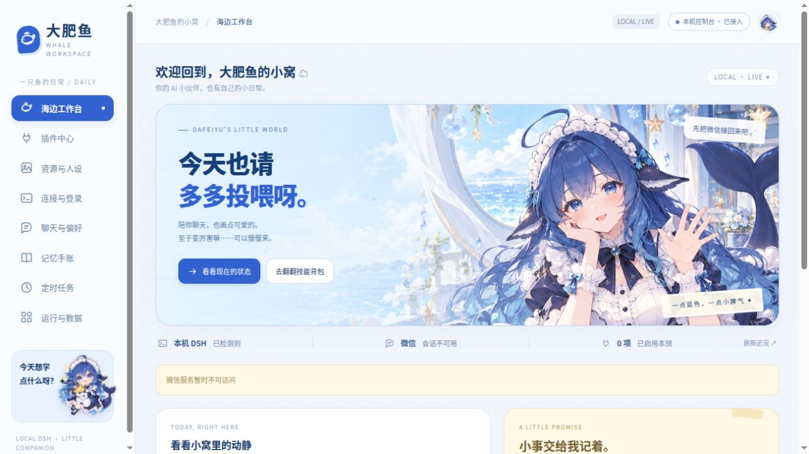

<p align="center">
  
</p>

<h1 align="center">鲸栖 · WhaleNest</h1>

<p align="center"><strong>让本机 DSH 里的 AI，成为微信里能聊天、发图、说话的小伙伴。</strong></p>

<p align="center">
  <a href="https://github.com/lovodllt/WhaleNest">GitHub</a> ·
  <a href="docs/QUICKSTART.md">快速开始</a> ·
  <a href="docs/MANUAL.md">手动安装</a> ·
  <a href="docs/FEATURES.md">功能配置</a> ·
  <a href="docs/RESOURCES.md">资源下载</a> ·
  <a href="AGENTS.md">Agent 指引</a>
</p>

鲸栖是基于本机 DeepSeek Harness（DSH）的微信 AI 陪伴项目，默认角色是蓝色鲸鱼娘“大肥鱼”。它把微信接入、角色工作台、记忆和定时任务放在同一套程序中，也支持按需接入联网、图片、语音和唱歌能力。

你可以在网页里调整聊天规则、管理人设与角色素材、查看记忆和安排提醒，也可以通过手机管理电脑上的服务。人设、设定集和大型模型由使用者自行导入或下载，功能按需要开启。

> 当前为 **0.1.0 预发布版**。支持 Linux，以及 Windows 的 Docker Desktop＋WSL2 方案；Linux 已完成独立环境检查与构建，Windows 尚待实体设备验证。详见 [验证记录](docs/VERIFICATION.md)。

## 功能

- **微信聊天**：私聊回复、群聊唤醒、引用回复、上下文接续与消息排队。自然参与按会话开启，不必句句回应。
- **角色与记忆**：自定义人设，自动提炼值得记住的内容；性格偏好和私聊记忆分开管理，可查看、纠正、置顶或忘记。
- **图片与表情**：接收图片和表情包，使用多模态模型识图；通过本机 Codex 生图，按人物设定集保持形象，并管理自己的表情素材。
- **声音**：接收微信语音，使用微软在线 TTS 或本地 GPT-SoVITS 回复；唱歌支持发送已经准备好的换声片段。
- **联网与任务**：聊天时按需要查询公开资料；内置一次、每日和每周提醒，以及已接入的重置预告监测。
- **可视化配置**：保留蓝色鲸鱼娘角色工作台，提供功能开关、依赖检查、素材导入与下载、记忆手账和任务列表；可选 Tailscale 手机私有访问。

基础聊天、消息队列、控制台和定时任务统一内置；可选插件与重型模型按需安装，配置入口集中在工作台中。

## 工作台预览



## 安装

### 环境要求

| 项目 | 要求 |
| --- | --- |
| 系统 | Linux x86_64；Windows 使用 Docker Desktop＋WSL2＋Ubuntu |
| Python | 推荐 3.12，需安装 venv |
| Node.js | 24，含 npm |
| 模型宿主 | 本机 DSH `0.2.1-rc.2`，配置自己的模型服务 |
| 微信环境 | Docker Engine／Docker Desktop、Docker Compose v2 |

主程序和 DSH 在宿主机或 WSL 中运行，Docker 运行固定版本的 Linux 微信 **4.1.13.26** 与 Webox。主聊天模型统一经过本机 DSH；安装器会检查所需插件。

### 一键配置

克隆仓库并进入项目目录：

```bash
git clone https://github.com/lovodllt/WhaleNest.git
cd WhaleNest
```

也可以[下载源码 ZIP](https://github.com/lovodllt/WhaleNest/archive/refs/heads/main.zip)，解压后进入项目根目录。

确认上述依赖已安装，再运行一键配置：

```bash
bash install.sh
```

向导会检查环境，创建本机配置，安装专用 DSH 插件，下载并校验微信安装包，再构建和启动服务。首次使用需要自行完成微信登录与主人绑定；操作步骤见 [一键配置教程](docs/QUICKSTART.md)。

Windows 先在 Docker Desktop 中启用 WSL 集成，再进入 Ubuntu 运行同一命令；也可使用项目内的 `install.ps1`。逐项安装依赖、配置自启和排查错误，见 [手动安装教程](docs/MANUAL.md)。

### 启动与停止

```bash
bash start.sh
bash stop.sh
```

- [角色工作台](http://127.0.0.1:8877/)：配置功能、素材、记忆和任务
- [微信登录画面](http://127.0.0.1:6860/vnc.html?autoconnect=1&resize=scale)：登录自己的微信账号

`stop.sh` 停止本项目的主程序并保留数据；微信容器需要单独停止时运行 `docker compose stop`。

## 在微信里使用

私聊可直接聊天，群聊通过当前微信昵称或“D老师”唤醒；唤醒词放在句中也可以。自然参与需要在对应群聊配置中开启，并以最近10分钟内出现过唤醒词为前提。

```text
D老师 /help
D老师 /task 明天9点提醒我喝水
D老师 /task 每天21点提醒我休息
D老师 /list_task
D老师 /imageGen 画一张蓝色鲸鱼娘求投喂 token 的表情包
```

语音、联网和图片功能开启后，可在聊天中提出对应请求。识图需要配置支持图片输入的模型；生图需要安装并登录本机 Codex；唱歌需要先准备音源与可发送的片段。具体配置见 [功能教程](docs/FEATURES.md)。

## 如果你是 Agent

> 请先阅读当前项目的 AGENTS.md 和 docs/QUICKSTART.md，检查本机环境，再按文档配置鲸栖。需要登录或输入密钥时提示我本人操作；不要读取其他实例的私有配置，也不要自行发送微信测试消息。完成后告诉我工作台地址、已启用功能和仍缺少的依赖。

[AGENTS.md](AGENTS.md) 说明了程序结构、配置入口、验证与发布约定。初次检查可以运行 `python3 scripts/manage.py check`；手动安装与详细参数以项目文档为准。

在远程 Agent 中接手时，项目地址为 `https://github.com/lovodllt/WhaleNest`。请先克隆仓库，再在实际运行 DSH 的电脑或 WSL 环境中执行配置。

## 可选资源与下载

**人设、原始图片设定集、聊天表情包、语音和唱歌模型权重不内置于源码压缩包或基础镜像。** 下表提供原始来源，使用者可以自行下载；软件“资源与人设”页面提供可选的一键下载或导入入口。自带的声音样本、歌曲和私人素材不公开。

| 资源 | 原始来源／手动下载入口 | 用途 |
| --- | --- | --- |
| 大肥鱼人设 | [dafeiyu-persona](https://github.com/ERUIHNIYHBKBNF/dafeiyu-persona) | 可选的初始人设；不包含维护者的私有教导与权限规则 |
| AI娘图片与文字设定 | [ai-chan-sheets](https://github.com/lmy414/ai-chan-sheets) | 角色形象与生图参考，按人物导入 |
| 表情包参考资源 | [deepseek-chan-meme-pack](https://github.com/the-beating-light-of-the-nail/deepseek-chan-meme-pack) | 可选表情包来源，也支持用户自行导入 |
| GPT-SoVITS | [程序仓库](https://github.com/RVC-Boss/GPT-SoVITS)、[模型权重](https://huggingface.co/lj1995/GPT-SoVITS) | 可选本地语音与音色模仿 |
| Seed-VC | [程序仓库](https://github.com/Plachtaa/seed-vc)、[模型权重](https://huggingface.co/Plachta/Seed-VC) | 唱歌换声首选方案，按需安装 |
| Vevo2／Amphion | [程序仓库](https://github.com/open-mmlab/Amphion)、[模型权重](https://huggingface.co/RMSnow/Vevo2) | 保留的实验对比方案，默认不启用 |
| BigVGAN | [程序仓库](https://github.com/NVIDIA/BigVGAN)、[44kHz 模型](https://huggingface.co/nvidia/bigvgan_v2_44khz_128band_512x) | 唱歌方案的声码器依赖 |
| Whisper | [程序仓库](https://github.com/openai/whisper)、[small 模型](https://huggingface.co/openai/whisper-small)、[medium 模型](https://huggingface.co/openai/whisper-medium) | 换声方案使用的编码器；按所选方案下载 |
| CAMPPlus | [模型来源](https://huggingface.co/funasr/campplus) | Seed-VC 的说话人特征依赖 |
| RMVPE | [当前模型来源](https://huggingface.co/lj1995/VoiceConversionWebUI) | 唱歌音高提取依赖 |
| Demucs | [程序与模型说明](https://github.com/facebookresearch/demucs) | 可选的人声、伴奏分离 |

微软在线语音通过 [edge-tts](https://github.com/rany2/edge-tts) 接入，不需要下载本地语音模型，但使用时需要联网；不将其描述为离线模型或微软官方 SDK。

资源中心默认提供人设、角色与模型管理界面，不要求先下载资源才显示入口。下载前显示来源、版本、大小、用途及许可；下载完成后校验文件并放入对应目录，下载失败可重试，也支持已下载文件的手动导入。模型下载与启用分开，不因下载而自动加载模型占用显存。前端自带大肥鱼界面插画；聊天使用的人设与生图参考集由使用者另行导入。

角色设定集按人物分目录，人物名作为目录名。文件名含“设定集”的图片优先作为形象依据，其他图片用于固定形象和扩展风格。模型只下载所选方案需要的文件，不将整个模型仓库全部拉取。资源目录与程序目录分离，升级不覆盖用户补充的设定和素材。

## 数据与配置

源码包不包含聊天记录、长期记忆、好友与群标识、主人绑定、密钥、微信登录状态、私人图片、声音样本或歌曲。它们保存在使用者自己的配置和数据目录中，升级前可以自行备份。

界面与 README 附带依据 DS 娘设定生成的配图，原始角色设定集仍需单独下载。使用在线模型、检索或在线语音时，相应输入会交给所配置的服务处理。

## 鸣谢

感谢以下开源项目及其贡献者。以下区分实际依赖、可选资源和实现参考，不将仅参考过的项目描述为运行依赖。

### 核心接入与运行依赖

| 项目 | 本项目中的用途 |
| --- | --- |
| [DeepSeek Harness](https://github.com/deepseek-ai/deepseek-harness) | 本机模型会话、工具调用与插件宿主 |
| [Webox](https://github.com/netcat-ai/webox) | Docker 内 Linux 微信及消息接口；本项目维护额外适配与辅助程序 |
| [dsh-mnemon](https://github.com/omdsh-dev/dsh-mnemon) | Mnemon 记忆存储和 Runtime Source；本项目另做作用域、提炼与管理界面 |
| [modsearch](https://github.com/liustack/modsearch) | 简单公开联网查询 |
| [dsh-kaomoji](https://github.com/TianJie52009/dsh-kaomoji) | 颜文字插件 |
| [Tesseract OCR](https://github.com/tesseract-ocr/tesseract) | 微信界面文字和目标定位辅助 |
| [FFmpeg](https://github.com/FFmpeg/FFmpeg) | 媒体处理；具体构建所包含的组件另行列明 |
| [Tailscale](https://github.com/tailscale/tailscale) | 可选的手机私有远程连接 |

### 可选语音、唱歌与角色资源

| 项目 | 本项目中的用途 |
| --- | --- |
| [edge-tts](https://github.com/rany2/edge-tts) | 微软在线语音接入与音色参数调整 |
| [GPT-SoVITS](https://github.com/RVC-Boss/GPT-SoVITS) | 保留的本地语音与音色模仿方案 |
| [Seed-VC](https://github.com/Plachtaa/seed-vc) | 当前首选唱歌换声方案 |
| [Amphion](https://github.com/open-mmlab/Amphion) | Vevo2 实验换声方案 |
| [Demucs](https://github.com/facebookresearch/demucs) | 人声与伴奏分离 |
| [BigVGAN](https://github.com/NVIDIA/BigVGAN) | 声码器 |
| [Whisper](https://github.com/openai/whisper) | 换声编码器相关组件 |
| [dafeiyu-persona](https://github.com/ERUIHNIYHBKBNF/dafeiyu-persona) | 可选人设来源，仅提供下载入口 |
| [ai-chan-sheets](https://github.com/lmy414/ai-chan-sheets) | 可选角色补全设定来源；原始角色形象归 ZipZipPipe，见原仓库授权说明 |
| [deepseek-chan-meme-pack](https://github.com/the-beating-light-of-the-nail/deepseek-chan-meme-pack) | 可选表情包来源，仅提供来源与导入入口 |

### 实现参考与上游来源

- [Kirara AI](https://github.com/lss233/kirara-ai)：参考消息触发、会话作用域和多模态工作流设计；本项目不以 Kirara 作为运行框架。
- [export-wechat-emoji](https://github.com/liusheng22/export-wechat-emoji)：参考表情图片缓存和复用方式。
- [wechat-emoticon](https://github.com/spacelan/wechat-emoticon)：参考表情消息中的 MD5、CDN 元数据提取思路。
- [wx-cli](https://github.com/jackwener/wx-cli)：Webox 的部分微信数据库解析代码注明来自该项目，保留上游 Apache-2.0 来源说明。2026-10-26 核对时该仓库返回 HTTP 451；不提供替代下载地址，该项列入正式发布前核查。

主要上游来源的核对记录见 [docs/upstream-sources.json](docs/upstream-sources.json)，第三方许可处理见 [THIRD_PARTY_NOTICES.md](THIRD_PARTY_NOTICES.md)。正式发布时随实际分发内容补齐对应许可证全文、版权声明、修改说明和依赖版本。


## 反馈与更新

遇到问题或有功能建议，欢迎到 [GitHub Issues](https://github.com/lovodllt/WhaleNest/issues) 反馈。请附上系统、DSH 版本、出错步骤和经过脱敏的错误信息。

升级、备份和故障处理见 [手动安装教程](docs/MANUAL.md)。更新程序前先保留自己的配置、聊天数据和素材；模型与素材无需每次重新下载。

## 许可证

本项目原创代码的许可证待维护者确定，当前预发布包不新增再分发授权。第三方代码、角色素材和模型权重分别遵守各自许可，详见 [LICENSE-STATUS.md](LICENSE-STATUS.md) 和 [THIRD_PARTY_NOTICES.md](THIRD_PARTY_NOTICES.md)。
